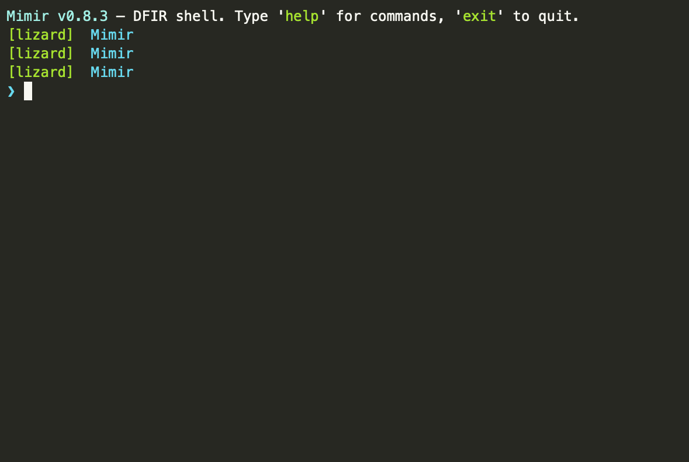

# Mimir

<p align="center">
  
</p>

<p align="center">
  <a href="https://github.com/yusif-v/mimir/releases"></a>
  <a href="https://go.dev"></a>
  <a href="LICENSE"></a>
</p>

**Mimir** is a DFIR (Digital Forensics and Incident Response) investigation shell. It gives you a full incident-response toolkit from an interactive REPL: open a case, add evidence, run analysis tools, watch IOCs get extracted and correlated automatically, and produce an incident report — with everything recorded on a searchable, exportable timeline.

Built for SOC analysts, incident responders, and forensic investigators who want a unified interface for their toolchain.

## Table of Contents

- [Quick Start](#quick-start)
- [Installation](#installation)
- [Features](#features)
- [Usage](#usage)
- [Documentation](#documentation)
- [Architecture](#architecture)
- [Configuration](#configuration)
- [Contributing](#contributing)
- [License](#license)

## Quick Start

```bash
git clone https://github.com/yusif-v/mimir.git
cd mimir
go build -o mimir ./cmd/mimir
./mimir
```

A five-minute investigation:

```
[user][mimir] ❯ case -n incident-42                    # create a case
[user][mimir] ❯ case -o incident-42                    # open it
[user][mimir][incident-42] ❯ evidence add sample.bin --tag malware,packed
[user][mimir][incident-42] ❯ run hash evidence/sample.bin
[user][mimir][incident-42] ❯ ioc --from-output hash
[user][mimir][incident-42] ❯ note suspicious packed binary
[user][mimir][incident-42] ❯ timeline
[user][mimir][incident-42] ❯ report
```

## Installation

### Requirements

- **Go 1.26+** (to build from source)
- **Docker** (optional, for containerized analysis tools)

### From source

```bash
git clone https://github.com/yusif-v/mimir.git
cd mimir
go build -o mimir ./cmd/mimir
```

### Pre-built binaries

Download the latest release for your platform from the [releases page](https://github.com/yusif-v/mimir/releases).

### Initialize config

```bash
./mimir config
```

This writes a default `~/.mimir/config.yaml`. See [configuration](docs/overview.md) for all options.

## Features

- **Interactive REPL** — readline-powered shell with history, tab completion (commands, tools, cases, files), Ctrl+R search, and shell passthrough.
- **Case management** — create, open, close cases; every action recorded on an immutable timeline.
- **Evidence & IOCs** — hash-tracked evidence with tags; automatic IOC extraction from tool output; cross-domain correlation and graphing.
- **Three tool kinds** — native Go builtins, Docker-backed catalog tools, and local binaries, all accessed through `run <tool>`.
- **First-class forensics** — `volatility` (memory), `sleuthkit` (disk), and `regripper` (Windows registry) as dedicated commands.
- **Sandbox** — disposable Docker containers for detonating and analyzing files safely.
- **AI assistant** — optional LLM integration for case analysis, next-step suggestions, and report narratives (OpenRouter, Anthropic, Ollama, or any OpenAI-compatible endpoint).
- **MCP server** — expose the investigation to Claude Desktop, Claude Code, or any MCP-compatible client.
- **Portable cases** — export to `tar.gz` (with provenance manifest) or JSON; import anywhere.
- **TUI dashboard** — interactive Bubble Tea tool explorer.
- **Theming** — YAML-based themes with four built-in presets (default, kali, minimal, no-color).

## Usage

### REPL commands

| Command | Description |
|---|---|
| `help` | List commands |
| `status` | Show the current case status |
| `case` | `-n <name> [-t <template>]` create, `-o <name>` open, `-c` close, `templates` |
| `cases` | List cases (`--status open\|closed`) |
| `tools` | List built-in, installed, and installable tools |
| `run <tool> [args...]` | Run a tool; output captured to the open case |
| `install <name>` / `build <name>` | Install a catalog tool / build its Docker image |
| `note <text>` | Add a note to the current case |
| `evidence` / `ev` | `add`, `tag`, `verify`, `classify` |
| `timeline` | Case timeline (`--type`, `--grep`, `-n`, `export`, `correlate`, `build`) |
| `ioc` | Extract from a file or tool output, `diff` sets, list tracked |
| `correlate [--dot]` | Cross-domain (memory/disk/network) IOC graph |
| `search` / `grep` | Search cases, notes, and tool output |
| `export` / `import` | Bundle / restore case archives (`tar.gz` or JSON) |
| `ai` | `ask`, `analyze`, `suggest`, `explain`, `summarize`, `config`, `use` |
| `plugin` | `list`, `run <name>`, `info <name>` |
| `theme` | `list`, `set <name>`, `save [path]` |
| `sandbox` | `create`, `run`, `shell`, `logs`, `report`, `cp`, `destroy`, `list` |
| `sleuthkit <tool>` | Disk forensics: fls, fsstat, icat, mmls, istat, ... |
| `regripper <hive>` | Windows registry hive analysis (`-p` plugin, `--json`) |
| `volatility <plugin>` / `mem` | Memory forensics (Volatility 3) |
| `analyze <path> [--rules <path>]` | Static malware analysis: auto yara/capa/oletools by file type |
| `report` | Generate an incident report (`md` or `pdf`) |
| `dashboard` / `dash` | Interactive TUI tool explorer |
| `clear` / `exit` / `quit` | Utility |

### MCP server

Run Mimir as an MCP server for integration with AI assistants:

```bash
./mimir mcp              # stdio transport (for Claude Desktop)
./mimir mcp --http :8080 # Streamable HTTP transport
```

### Shell passthrough

Any command not recognized by Mimir is passed to your shell, so you can use `ls`, `cat`, `grep`, etc. without leaving the REPL.

## Documentation

Full documentation lives in [`docs/`](docs/):

| Document | Topic |
|---|---|
| [Overview & configuration](docs/overview.md) | Architecture, directory layout, config reference, REPL behavior |
| [Cases & notes](docs/cases.md) | Case management, notes |
| [Evidence, IOCs & timeline](docs/evidence.md) | Evidence handling, IOCs, timeline |
| [Tools: builtins & catalog](docs/tools.md) | Built-in tools and Docker catalog |
| [Memory, disk & registry analysis](docs/analysis.md) | Volatility, SleuthKit, RegRipper |
| [Sandbox](docs/sandbox.md) | Docker sandbox for file detonation |
| [AI assistant](docs/ai.md) | LLM integration guide |
| [Reporting, export & themes](docs/reporting.md) | Report generation, case export, theming |
| [MCP server](docs/mcp.md) | MCP server setup and tool surface |
| [Plugins](docs/plugins.md) | Plugin system guide |

## Architecture

Mimir stores everything under `~/.mimir/`:

```
~/.mimir/
├── config.yaml          # configuration
├── investigations/      # case data (one directory per case)
├── tools/               # installed Docker-based tools
├── plugins/             # plugin manifests
├── cache/               # downloaded tool images
├── logs/                # session logs
└── history              # REPL command history
```

The codebase is organized as:

```
mimir/
├── cmd/mimir/           # entry point
├── internal/            # core packages
│   ├── ai/              # LLM integration
│   ├── builtins/        # native Go analysis tools
│   ├── casearchive/     # case export/import
│   ├── cases/           # case management
│   ├── catalog/         # Docker tool catalog
│   ├── config/          # configuration loading
│   ├── events/          # internal event bus
│   ├── ioc/             # IOC extraction
│   ├── mcp/             # MCP server
│   ├── plugins/         # plugin system
│   ├── sandbox/         # Docker sandbox
│   ├── shell/           # REPL
│   ├── theme/           # theming
│   ├── tools/           # tool execution engine
│   └── ui/              # terminal UI
├── docs/                # user documentation
└── config/              # example config
```

## Configuration

Mimir reads configuration from `~/.mimir/config.yaml` (or a path set via `MIMIR_CONFIG`). Run `mimir config` to generate a default config file.

Key sections:

- **`ai`** — LLM provider settings (provider, model, API key)
- **`tools`** — Docker tool defaults (memory limits, timeout, network mode)
- **`sandbox`** — Sandbox defaults (capability dropping, seccomp, read-only root)
- **`theme`** — Active theme name

See [docs/overview.md](docs/overview.md) for the full configuration reference.

## Contributing

Contributions are welcome! Please see [CONTRIBUTING.md](CONTRIBUTING.md) for guidelines.

## License

Mimir is released under the [MIT License](LICENSE).
